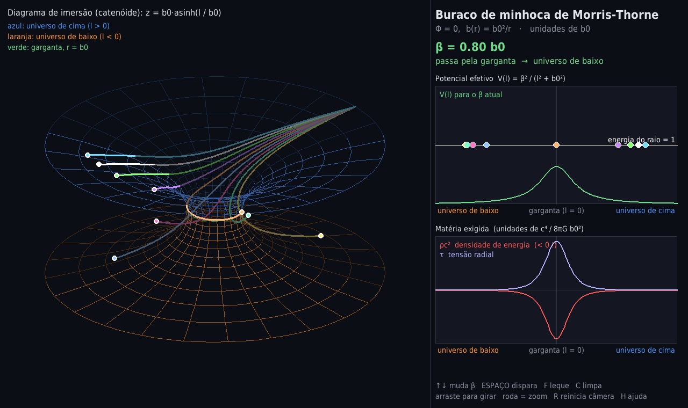

# Simulação: buraco de minhoca de Morris & Thorne (1988)



Simulação interativa do exemplo mais simples do artigo: Φ = 0 e b(r) = b0²/r.

- **Esquerda:** o diagrama de imersão (um catenóide) em 3D, com raios de luz andando sobre a superfície. Azul é o universo de cima (l > 0), laranja o de baixo (l < 0), verde a garganta.
- **Direita, em cima:** o potencial efetivo V(l) = β²/(l² + b0²). Cada fóton tem "energia" 1 e fica sobre a linha branca. Se a curva passa da linha, o fóton bate e volta.
- **Direita, embaixo:** a matéria que as equações de Einstein exigem. A densidade de energia é **negativa**: é a matéria exótica.

## Como rodar

Esta pasta **não** tem ambiente próprio: ela usa o ambiente único da raiz do projeto. Na primeira vez, na raiz:

```bash
uv sync
```

Depois, dentro desta pasta:

```bash
uv run main.py
```

Para rodar o autoteste da física (sem janela):

```bash
uv run fisica.py
```

## Controles

| Tecla | Ação |
| --- | --- |
| ↑ / ↓ | muda o parâmetro de impacto β (a "mira" do raio) |
| Espaço | dispara um raio com o β atual |
| F | dispara um leque de 9 raios, com β de 0 a 2 b0 |
| C | apaga os raios |
| Arrastar com o mouse, ← → | gira a câmera |
| Roda do mouse, + − | zoom |
| R | volta a câmera ao início |
| H | mostra ou esconde a ajuda |
| Esc | sai |

## Experimentos para fazer

1. **A regra β < b0.** Dispare raios com β = 0,9 e β = 1,1. Um atravessa, o outro volta. Olhe o gráfico do potencial: o pico na garganta vale β²/b0², então passa de 1 exatamente quando β > b0.
2. **A órbita da garganta.** Coloque β = 1,00 e dispare. O raio fica dando voltas em torno da garganta (círculo verde). A órbita é instável: o erro numérico acaba empurrando o raio para um dos lados.
3. **Lente gravitacional.** Aperte F. Raios que partem do mesmo ponto saem em direções muito diferentes. Para quem está do outro lado, a garganta funciona como uma lente.
4. **Matéria exótica.** Repare que a curva vermelha (ρc²) é negativa em todo lugar e mais intensa na garganta. Compare com a seção 8 da explicação.

## Arquivos

- `fisica.py`: só matemática (geometria, matéria, geodésicas com Runge-Kutta 4). Não depende do pygame.
- `main.py`: desenho e interação com pygame.
- As dependências ficam no `pyproject.toml` da raiz do projeto.
